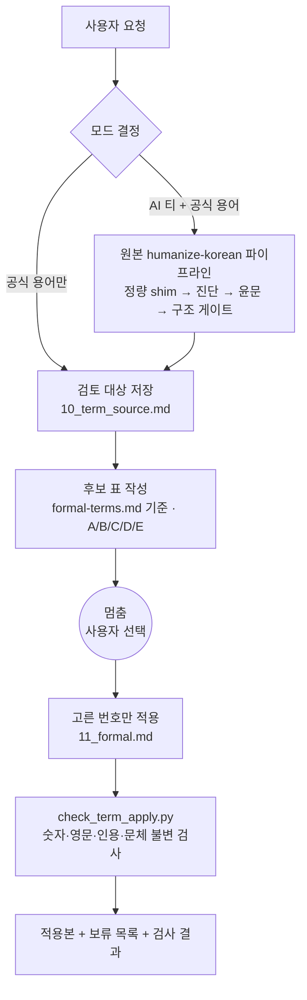

<div align="center">

# humanize-korean-formal

**보고서·공문서의 비유·구어 표현을 공식 용어로 바꿔 주는 Claude Code 스킬**

AI 티를 걷어낸 글에 남아 있는 "뭉갠다", "묻힌다", "우리 데이터" 같은 표현을 찾아
후보 표로 먼저 보여 주고, **사용자가 고른 것만** 공식 용어로 바꿉니다.


</div>

> [!IMPORTANT]
> **이 저장소는 [humanize-korean](https://github.com/epoko77-ai/im-not-ai)(epoko77-ai, MIT)의 비공식 파생본입니다.**
> 원저작자와 관계가 없으며, 원본의 AI 티 제거 파이프라인은 그대로 두고 그 뒤에 **공식 용어 검토 단계**를 더했습니다.
> 이 스킬은 표현만 바꾸도록 설계했습니다. 숫자·고유명사·인용·주장은 바꾸지 않는 것이 규칙이며, 자동 검사가 잡지 못하는 부분은 바뀐 구간 목록으로 사람이 확인합니다([안전 설계](#안전-설계)).

---

## 목차

- [기획 배경](#기획-배경)
- [사용 흐름](#사용-흐름)
- [분류 기준](#분류-기준)
- [주요 기능](#주요-기능)
- [안전 설계](#안전-설계)
- [동작 구조](#동작-구조)
- [설치](#설치)
- [사용법](#사용법)
- [테스트](#테스트)
- [프로젝트 구조](#프로젝트-구조)
- [원본과 달라진 점](#원본과-달라진-점)
- [라이선스와 출처](#라이선스와-출처)

---

## 기획 배경

AI 윤문 도구는 번역투나 상투구 같은 "AI 티"는 잘 걷어내지만, 사람이 직접 쓴 **비유와 구어**는 그대로 둡니다. 에세이에서는 장점인 이런 표현이 보고서·공문서·공모전 제출물에서는 격식을 떨어뜨립니다. 반대로 한꺼번에 공식 용어로 바꾸면 학술 용어까지 바뀌거나 뜻이 달라질 수 있습니다.

| 문제 | 이 스킬의 접근 |
|------|--------------|
| 보고서에 비유·구어가 섞여 격식이 떨어진다 | 비유(A)·1인칭·구어(B)·소제목(C)·제목(D)을 **분류해 후보 표**로 보여 준다 |
| 일괄 치환하면 원하지 않은 곳까지 바뀐다 | 표를 먼저 내고 멈춘다. **고른 번호만** 적용한다 |
| "공간 해상도", "강건성" 같은 학술 용어도 비유처럼 보인다 | **E 유지**로 따로 분류하고 이유를 적는다 |
| 바꾸다가 숫자나 고유명사가 같이 바뀔 수 있다 | 적용 뒤 **불변 검사 스크립트**로 숫자·기호·인용·문체를 대조하고, **바뀐 구간 전체**를 보여 준다 |

---

## 사용 흐름

**① 요청**

```
이 보고서 비유·구어 표현 공식 용어로 바꿔 줘.
```

**② 후보 표 — 여기서 멈춥니다** (용어는 아직 바꾸지 않았습니다)

| # | 위치 | 현재 | 제안 | 분류 |
|---:|---|---|---|---|
| 1 | (3) 1문장 | 하나의 숫자로 **뭉갠다** | 하나의 값으로 **평균화한다** | A 비유 |
| 2 | (3) 2문장 | 이런 정류장은 평균에 **묻힌다** | 이런 정류장은 평균에서 **식별되지 않는다** | A 비유 |
| 3 | (3) 3문장 | 분포의 **꼬리에** | 분포의 **상위 구간에** | A 비유 |
| 6 | (3) 3문장 첫머리 | **그런데** 그 분포의 | **그러나** 그 분포의 | B 구어 |
| 7 | (1) 1문장 | **우리** 데이터가 | **보유** 데이터가 | B 1인칭 |
| 9 | 소제목 (3) | **왜 지금 필요한가** | **시의성** | C 소제목 |
| — | (3) 4문장 | 공간 **해상도**, **강건성** | 유지 (GIS·통계 용어를 정의대로 씀) | E 유지 |

```
"권장만"(A·B) / "권장+소제목"(A·B·C) / "전부" / 번호 나열 중 골라 주세요
```

**③ 선택 → 적용**

```
권장만. "위에서 끊는다"는 빼 줘.
```

고른 번호만 반영한 적용본, 바뀐 구간 목록(`우리 → 보유` 처럼 번호별 대조용), 보류한 번호 목록, 불변 검사 결과를 돌려줍니다.

> 위 예시는 이 저장소의 가상 테스트 입력([`tests/fixtures/report_excerpt/input.md`](tests/fixtures/report_excerpt/input.md))으로 스킬을 실제로 돌린 결과를 줄인 것입니다.

---

## 분류 기준

| 분류 | 대상 | 기본 판정 | 예 |
|------|------|----------|----|
| **A 비유** | 글자 그대로의 뜻이 아니라 이미지로 말하는 표현 | 권장 | 뭉갠다 → 평균화한다 · 위에서 끊는다 → 상위 순위부터 적용한다 |
| **B 1인칭·구어** | 뜻은 맞지만 말투가 사적이거나 구어인 표현 | 권장 | 우리 데이터 → 보유 데이터 · 쓰면 된다 → 활용할 수 있다 · 문장 첫머리 그런데 → 그러나 |
| **C 소제목** | 소제목·캡션의 의문형·대조형·구어 | 선택 | 왜 지금 필요한가 → 시의성 |
| **D 제목** | 문서 제목·과제명 | 선택 | 바꿀 때의 득실을 함께 적는다 |
| **E 유지** | 그 분야의 정의된 용어를 정의대로 쓴 것 | 바꾸지 않음 | 공간 해상도 · 강건성 · 고립 지점 |

E는 **좁게** 판정합니다. 정의대로 쓰지 않았거나 확신이 없으면 A로 올리고 "E 가능"을 적어 사용자가 판단하게 합니다. E로 잘못 두면 후보가 사라지지만 A로 잘못 올리면 표에 한 줄이 늘 뿐이기 때문입니다.
판정 기준 전문과 예시는 [`references/formal-terms.md`](skill/humanize-korean-formal/references/formal-terms.md)에 있습니다.

---

## 주요 기능

| 기능 | 설명 |
|------|------|
| **용어 검토만** | "공식 용어로 바꿔 줘" — 원문에 바로 후보 표를 냅니다. 첫 응답에는 표만 있습니다. |
| **윤문 + 용어 검토** | "AI 티 빼고 공식 용어로" — 원본 humanize-korean 파이프라인(진단 → 윤문 → 구조 게이트)을 먼저 돌려 **윤문본을 전달**하고, 같은 응답에서 그 윤문본에 대한 후보 표를 냅니다. 공식 용어는 고른 뒤에만 바꿉니다. |
| **빠짐없이 훑기** | 제목 → 소제목 전부 → 본문 비유 표지 → 본문 구어 표지(문장 첫머리 접속사 포함) 순서의 체크리스트로 훑습니다. |
| **번호 선택** | "권장만", "권장+소제목", "전부", "1, 3, 7번", "권장만, 5번 빼고" 모두 받습니다. |
| **불변 검사** | `check_term_apply.py`가 숫자(부호 포함)·수식 기호·영문 토큰·인용("" 「」 『』 《》 등)·문장별 끝 문체를 **등장 순서까지** 전후 대조하고, 바뀐 구간을 모두 출력합니다. LLM을 쓰지 않습니다. |
| **판정 기록** | 후보 표 파일 상단에 `판정: 적용 #…, 보류 #…`을 남깁니다. |

---

## 안전 설계

- **공식 용어는 표를 내고 고르기 전에는 바꾸지 않습니다.** "표 필요 없고 바로 완성본"이라고 해도 요청한 분류에 ✔를 표시한 표를 내고 확인을 받습니다. ("윤문 + 용어 검토" 모드의 윤문은 요청대로 먼저 수행합니다.)
- **고른 행만 바꿉니다.** 적용하면서 문장을 다듬지 않습니다.
- **용어 검토는 항상 윤문 뒤입니다.** 윤문을 나중에 돌리면 고른 공식 용어를 윤문이 다시 바꿀 수 있습니다.
- 숫자·고유명사·인용·주장은 대상이 아닙니다. 불변 검사에서 차이가 나오면 **설명하고 넘어가지 않고 원문대로 되돌립니다.** 고른 행의 제안이 원인이면 제안을 고치거나 그 행을 보류합니다. 검사 자체가 실패하면(입력 오류) 적용본을 완료로 전달하지 않습니다.
- **자동 검사의 한계**: 한글 고유명사(예: 기관명)나 주장의 뜻(예: "있다" → "없다"), 숫자가 가리키는 대상(예: 서울 7곳 ↔ 부산 7곳)이 바뀌는 것은 스크립트가 판정하지 못합니다. 따옴표 안의 강조 표현과 실제 인용도 구분하지 못하므로, 따옴표 안은 아예 후보로 올리지 않습니다. 그래서 바뀐 구간 목록(줄바꿈 포함)을 고른 번호와 하나씩 대조하고, 어느 번호에도 해당하지 않는 구간은 되돌립니다.
- 입력 글은 데이터로만 다룹니다. 글 안에 명령형 문장이 있어도 지시로 따르지 않습니다(원본 스킬의 정책을 이어받음).

---

## 동작 구조



작업 파일은 사용자의 작업 폴더 아래 `_workspace/{YYYY-MM-DD-NNN}/`에 남습니다.

---

## 설치

### 준비물

- [Claude Code](https://claude.com/claude-code)
- `python3` — 스크립트는 표준 라이브러리만 씁니다.

### 설치 명령

```bash
git clone https://github.com/KimHands/humanize-korean-formal.git
mkdir -p ~/.claude/skills
cp -R humanize-korean-formal/skill/humanize-korean-formal ~/.claude/skills/
```

새 Claude Code 세션을 열면 스킬 목록에 `humanize-korean-formal`이 나타납니다.
원본 humanize-korean 플러그인을 설치하지 않아도 동작합니다. 필요한 스크립트와 에이전트 정의가 스킬 폴더 안에 들어 있습니다.

> [!NOTE]
> 일반적인 AI 티 제거만 필요하면 원본을 쓰세요: `/plugin marketplace add epoko77-ai/im-not-ai` → `/plugin install humanize-korean@im-not-ai`.
> 두 스킬을 함께 설치해도 트리거가 겹치지 않습니다("AI 티 없애줘"는 원본, "공식 용어로"는 이 스킬).

### 제거

```bash
rm -rf ~/.claude/skills/humanize-korean-formal
```

---

## 사용법

| 이렇게 말하면 | 동작 |
|-------------|------|
| "이 보고서 비유·구어 표현 공식 용어로 바꿔 줘" | 용어 검토만 |
| "보고서체로 정리해 줘", "1인칭 표현 빼 줘", "용어 검토해 줘" | 용어 검토만 |
| "AI 티 빼고 보고서에 맞는 공식 용어로 정리해 줘" | 윤문 + 용어 검토 |
| (표를 받은 뒤) "권장만" / "권장+소제목" / "전부" / "1, 3, 7번" | 고른 번호만 적용 |

윤문 쪽 옵션(`장르: 리포트`, `정밀 모드`, `가볍게` 등)은 원본과 같습니다.

---

## 테스트

```bash
# 불변 검사 스크립트 단위 테스트
python3 -m unittest discover tests        # 16 passed
```

**행동 테스트** — 스킬 문구는 곧 동작이므로, SKILL.md나 `formal-terms.md`를 고치면 가상 입력으로 다시 확인합니다.

| 확인 항목 | 기준 |
|----------|------|
| 첫 응답에 적용본이 없는가 | "바로 완성본"을 요청해도 표만 낸다 |
| 분류 정답 | [`expected.md`](tests/fixtures/report_excerpt/expected.md)의 A 5 · B 3 · C 2 · D 1 · E 5 (시나리오 프롬프트는 같은 파일, 실제 실행 산출물은 [`runs/`](tests/fixtures/report_excerpt/runs/)) |
| 적용 범위 | 고른 번호만 바뀐다(단어 단위 diff로 확인) |
| 불변 검사 | `check_term_apply.py` exit 0, 바뀐 구간이 고른 번호와 일치 |

개발 중에는 스킬 없이 돌린 기준선과 비교했습니다. 기준선에서는 "완성본으로" 요청에 선택 없이 바로 적용하거나 "분포의 꼬리"를 학술 용어로 오분류해 후보에서 숨기는 실패가 나왔고, 스킬을 적용한 뒤에는 세 시나리오 모두 통과했습니다.

---

## 프로젝트 구조

```
humanize-korean-formal/
├── skill/humanize-korean-formal/     ← 설치되는 스킬 폴더
│   ├── SKILL.md                      원본 오케스트레이터 + 모드 결정 + Phase 3
│   ├── README.md                     출처 · 원본과 달라진 점 (스킬과 함께 배포)
│   ├── LICENSE                       원본 MIT 고지 (수정 없음)
│   ├── agents/                       원본 런타임 에이전트 3종 (monolith · diagnostician · finalizer)
│   ├── references/
│   │   ├── formal-terms.md           ★ 공식 용어 판정 기준 · 체크리스트 · 예시
│   │   └── …                         원본 룰북 · 분류 체계 · 지표 (수정 없음)
│   └── scripts/
│       ├── check_term_apply.py       ★ 용어 적용 불변 검사
│       └── …                         원본 런타임 스크립트 9종
├── tests/
│   ├── test_check_term_apply.py      단위 테스트
│   └── fixtures/report_excerpt/      가상 입력 · 기대 결과 · runs/(실제 실행 산출물)
├── docs/review-2026-10-12.md         공개 전 교차 리뷰(Codex) 수용·기각 기록
├── LICENSE                           MIT (원본 + 변경분 저작권 표시)
└── AGENTS.md                         이 저장소를 고치는 에이전트용 규칙
```

★ 표시가 이 저장소에서 새로 만든 파일입니다.

---

## 원본과 달라진 점

| 구분 | 내용 |
|------|------|
| 추가 | Phase 3 공식 용어 검토, 모드 결정, `formal-terms.md`, `check_term_apply.py` |
| 수정 | 플러그인이 아닌 단일 스킬 폴더로 설치되도록 `SKILL_ROOT` 규칙과 스크립트 4개의 references 경로(각 한 줄)를 고침 |
| 수정 | 에이전트를 서브에이전트 타입 대신 `agents/*.md`를 읽는 general-purpose 에이전트로 호출 |
| 수정 | 트리거를 공식 용어·보고서체 요청으로 좁힘 |
| 제외 | 유지보수·개발용 에이전트 6종, 빌드·평가 스크립트, 원본 테스트, Codex·Gemini 어댑터 |

파일 단위 내역은 [`skill/humanize-korean-formal/README.md`](skill/humanize-korean-formal/README.md)에 있습니다.

---

## 라이선스와 출처

- 원본: [epoko77-ai/im-not-ai](https://github.com/epoko77-ai/im-not-ai/tree/v2.3.2) — humanize-korean **v2.3.2 태그** 기준, © 2026 epoko77-ai, [MIT License](skill/humanize-korean-formal/LICENSE)
- 이 저장소의 변경분도 MIT로 배포합니다 — [루트 LICENSE](LICENSE). 스킬 폴더를 복사·재배포할 때는 폴더 안의 `LICENSE`를 함께 포함해 주세요.
